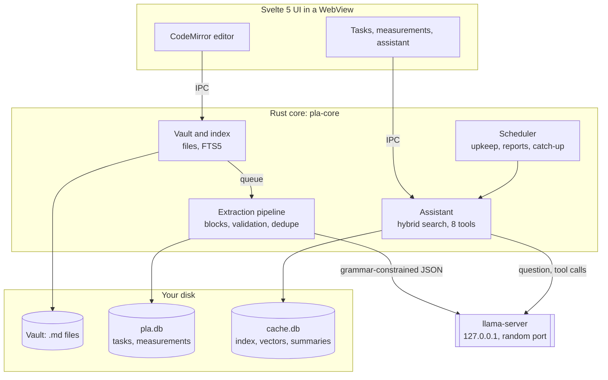

<div align="center">



<br>

PLA is a desktop notes app that reads your Markdown notes with a small language model running on your own CPU, and turns what you wrote into tasks, reminders and health measurements. It works offline.

<br>

-0f7a63?style=flat-square)


[](LICENSE)

[What it does](#what-it-does) · [Limits](#limits) · [Install](#install) · [Benchmarks](#benchmarks) · [How it works](#how-it-works) · [Privacy](#privacy) · [Türkçe](README.tr.md)

</div>

## Why I built this

I write everything down in Markdown notes: what I have to do tomorrow, how I slept, what I lifted at the gym. Then I used to copy the same lines into a to-do app, a habit tracker and a calendar by hand. PLA does that copying for me. A 2B-parameter model reads the notes on my laptop, so none of it goes to a server, and I don't need an account or an API key.

I'm the first user, and many of the test cases started as screenshots of messages PLA got wrong.

<table>
<tr>
<td align="center"><h3>27&nbsp;MB</h3>RAM while it waits in the tray</td>
<td align="center"><h3>1.72&nbsp;s</h3>cold start with 10,000 notes</td>
<td align="center"><h3>91%</h3>extraction accuracy on unseen TR and EN notes</td>
<td align="center"><h3>1.85&nbsp;GB</h3>RAM while the model runs</td>
<td align="center"><h3>~42&nbsp;s</h3>to the assistant's first answer, CPU only</td>
</tr>
</table>

## What it does

- Opens a folder of Markdown notes, including an existing Obsidian vault. Wikilinks, tags, YAML properties, backlinks, a graph view and full-text search all work. PLA doesn't touch `.obsidian/` and won't overwrite a file that changed outside it.
- When you leave a note, or stop typing for 45 seconds, the model reads the blocks that changed and files tasks, reminders and measurements (sleep, weight, workouts). Rust computes the dates from the note's own date, so "tomorrow" written in yesterday's note lands on the right day.
- Items the model added carry a ✦ badge, an Undo, and a link to the line they came from. Once you edit, complete or delete one, the model leaves it alone. Fixing a typo doesn't create a duplicate, because blocks are matched by position and text similarity.
- The assistant panel answers questions from your notes, names the notes it used, and gets sums and averages from SQL. It can search, query tasks and measurements, add or complete a task, log a measurement and create a note. None of its tools deletes anything.
- Reminders arrive as desktop notifications. Weekly routines ("gym Mon/Wed/Fri at 7") and a weekly report, written as a note on Sunday, are built in; anything missed while the laptop was off is caught up on the next start.
- PDF import without a model: the file goes to `attachments/` and its text to a Markdown note in `sources/` that search and the assistant can read. Scanned PDFs are recognized but not OCR'd.
- The first run offers Gemma 4 E2B (a 2.5 GB download) and fetches it once you agree. If Ollama, LM Studio, the Hugging Face cache, GPT4All, Jan or llama.cpp already put GGUF models on your disk, PLA lists them and uses them where they are.
- A copy of the database goes into the vault's `.pla/backup/` every day, so copying the vault folder backs up your tasks too. A damaged database is set aside, not deleted, and PLA offers the latest backup.
- The interface is in Turkish and English; notes can be in any language the model reads.

## Limits

- The assistant is slow on a CPU: about 42 s to the first answer on 3 threads, 64 s if it calls a tool. Each question adds around 1,700 tokens of notes and instructions, and a CPU processes about 50 tokens a second. There is no GPU build yet.
- On phrasings unlike its examples, the assistant gets 80 to 87% of requests right. A message that mixes a task and a measurement sometimes records only one of them.
- Extracting a note with 10 changed blocks takes about 46 s. It runs in the background.
- Windows is where PLA is tested. Linux builds and runs from source; macOS hasn't been tried.
- The Windows installer isn't code-signed, so SmartScreen warns once. There is no prebuilt Linux or macOS package.
- Files are stored as plain text. Disk encryption is up to the OS.

## Install

You need a 64-bit x86 CPU with 4 cores (AVX2 not required), 8 GB of RAM and about 5 GB of disk. A GPU isn't used.

**Windows:** download `PLA_<version>_x64-setup.exe` from [Releases](https://github.com/AyberkCerit/personal_life_assistant/releases/latest) and run it. It needs no admin rights. SmartScreen warns once because the installer isn't signed: choose **More info → Run anyway**. The language model isn't in the installer; PLA offers to download it on first run. [`docs/INSTALL.md`](docs/INSTALL.md) covers checking the download, updating and uninstalling.

**From source** (Linux, or Windows for development):

```bash
git clone https://github.com/AyberkCerit/personal_life_assistant.git
cd personal_life_assistant/apps/desktop
npm install
npm run fetch-pdfium                 # on Linux: npm run fetch-pdfium -- --platform linux-x64
npm run tauri dev
```

This needs stable Rust, Node.js and the [Tauri 2 prerequisites](https://v2.tauri.app/start/prerequisites/). For the language model, either bundle llama.cpp with `npm run fetch-llama -- --from <llama.cpp b11280 folder>` or point `PLA_LLAMA_SERVER` at an existing `llama-server` binary.

`npm run release` builds the same per-user Windows installer locally. The one on Releases is built by [`windows-installer.yml`](.github/workflows/windows-installer.yml) when a release is published.

```bash
cargo test --workspace               # Rust: core and desktop shell
cd apps/desktop && npm test          # UI: Vitest
```

## Benchmarks

I picked the model by scoring five candidates on the same 200 messy Turkish and English notes. A model had to reach 80% field accuracy in both languages and fit in 2 GB.


| Result | Value | Cases |
|---|---|---:|
| Extraction field accuracy, notes written after the prompt was frozen | 91% TR, 91% EN | 200 |
| Valid JSON from grammar-constrained output | 100%, all five models | 200 |
| Performance limits met on a generated 10,000-note vault | 10 of 10 | |
| Assistant suite, 10 October 2026 | 117 of 122 | 122 |
| Assistant on held-out phrasings | 12 of 15 | 15 |
| Answer reaches the context through `[[links]]` | 21 of 22 | 22 |

Some of these sets are small. [`BENCHMARKS.md`](BENCHMARKS.md) has the full tables, the failures, the before-and-after performance fixes, and the commands to rerun everything.

## How it works



Rust handles dates, sums and averages, and the model only writes text, because small models get arithmetic wrong. `llama-server` is a child process that starts when there is work and stops 60 s after the last request, which is the surest way to give its memory back. Automation never deletes your notes or records; summaries live in `cache.db`, which can be rebuilt. Generated notes (reports, PDF imports) are marked `pla_generated: true` and skipped by extraction.

<details>
<summary>One note, end to end</summary>

<br>

You write in `daily/2026/2026-09-26.md`:

> Yarın sabah 8'de kalkıp omuz çalışacağım, shoulder press hedefi.

The model, constrained by a JSON schema, returns only relative time:

```json
{"items": [{"type": "task", "title": "Omuz antrenmanı", "details": "shoulder press",
            "when": {"day_offset": 1, "time": "08:00"}}]}
```

Rust validates it, resolves the date against the note's date and stores it with its source block:

```json
{"type": "task", "title": "Omuz antrenmanı", "details": "shoulder press",
 "date": "2026-09-27", "time": "08:00",
 "source": {"note": "daily/2026/2026-09-26.md", "block_id": "blk_8f3a"}, "origin": "extracted"}
```

Nothing is written into the note. Output that fails validation goes to a Review box instead of the task list.
</details>

## Privacy

| Layer | What enforces it |
|---|---|
| Rust | Two places hold an HTTP client: the model downloader (HTTPS to an allow-list of hosts) and the client that talks to `llama-server` over loopback. |
| WebView | Content Security Policy `default-src 'self'` in [`tauri.conf.json`](apps/desktop/src-tauri/tauri.conf.json) and a minimal Tauri capability list. |
| Model server | `llama-server` listens on `127.0.0.1`, on a random port, with a new API key each run. Only Rust talks to it. |
| Prompt injection | A note that tells the model to delete everything reaches a model whose tools can't delete. Test: `engine::instructions_in_a_note_reach_no_tool_outside_the_list_and_no_check_is_skipped`. |
| Updates | PLA doesn't check for updates over the network. |

## Status

PLA is at v0.1 and I'm its only developer. Six of the seven MVP acceptance criteria pass; the seventh, using PLA as my only notes and task app for four weeks, runs until 13 November 2026. Next on the list: two-way sync between `- [ ]` checkboxes and tasks, watching files live while Obsidian is open, optional encryption, richer repeat rules and a GPU build.

## Contributing

The most useful contribution is a failing case: a note or a question PLA got wrong, pasted into an issue or added to `crates/pla-core/tests/nl/`. Benchmark runs on other hardware help too, especially slower laptops and AMD CPUs, as does a new interface language in `apps/desktop/src/lib/i18n.ts`. Read [`DESIGN.md`](DESIGN.md) before changing a screen. Commits follow Conventional Commits.

## License

[MIT](LICENSE) © 2026 Ayberk Cerit. llama.cpp (MIT) and PDFium ship with their own notices in `apps/desktop/src-tauri/llama-licenses/` and `apps/desktop/src-tauri/pdfium/`. Model weights aren't bundled; Gemma 4 E2B and EmbeddingGemma download on first run under their own licenses.
