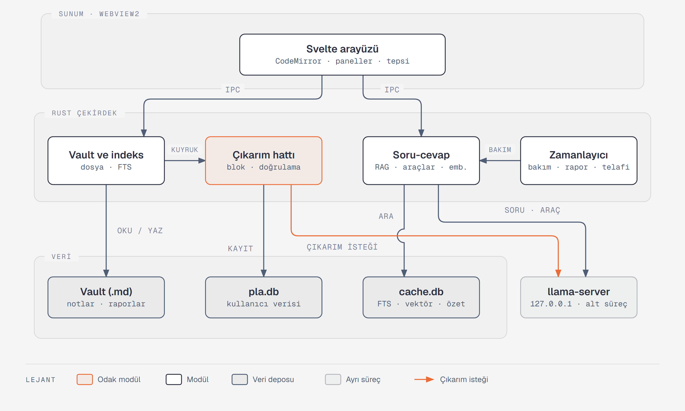

<div align="center">



<br>

PLA, Markdown notlarını kendi işlemcinde çalışan küçük bir dil modeliyle okuyan ve yazdıklarını görev, hatırlatıcı ve sağlık ölçümüne çeviren bir masaüstü not uygulaması. İnternetsiz çalışır.

<br>

-0f7a63?style=flat-square)


[](LICENSE)

[Neler yapar](#neler-yapar) · [Sınırlar](#sınırlar) · [Kurulum](#kurulum) · [Ölçümler](#ölçümler) · [Nasıl çalışır](#nasıl-çalışır) · [Gizlilik](#gizlilik) · [English](README.md)

</div>

## Neden yaptım

Her şeyi Markdown notlarına yazıyorum: yarın ne yapacağımı, nasıl uyuduğumu, sporda ne kaldırdığımı. Sonra aynı satırları elle bir yapılacaklar uygulamasına, bir alışkanlık takipçisine ve takvime taşıyordum. Bu taşımayı artık PLA yapıyor. Notları dizüstümde 2B parametreli bir model okuyor; hiçbiri bir sunucuya gitmiyor, hesap ya da API anahtarı da gerekmiyor.

İlk kullanıcısı benim. Test vakalarının çoğu, PLA'nın yanlış anladığı mesajların ekran görüntülerinden çıktı.

<table>
<tr>
<td align="center"><h3>27&nbsp;MB</h3>tepside beklerken RAM</td>
<td align="center"><h3>1,72&nbsp;sn</h3>10.000 notla soğuk açılış</td>
<td align="center"><h3>%91</h3>hiç görülmemiş TR ve EN notlarda çıkarım doğruluğu</td>
<td align="center"><h3>1,85&nbsp;GB</h3>model çalışırken RAM</td>
<td align="center"><h3>~42&nbsp;sn</h3>asistanın ilk cevabına kadar, yalnız CPU</td>
</tr>
</table>

## Neler yapar

- Mevcut bir Obsidian kasası dahil, Markdown notlarından oluşan bir klasörü açar. Wikilink'ler, etiketler, YAML özellikleri, geri bağlantılar, grafik görünümü ve tam metin arama çalışır. PLA `.obsidian/` klasörüne dokunmaz ve dışarıda değişmiş bir dosyanın üzerine yazmaz.
- Bir nottan çıktığında ya da 45 saniye yazmadığında model değişen blokları okur; görevleri, hatırlatıcıları ve ölçümleri (uyku, kilo, antrenman) kaydeder. Tarihleri Rust notun kendi tarihinden hesaplar, böylece dünkü nota yazılan "yarın" doğru güne düşer.
- Modelin eklediği öğelerde ✦ rozeti, Geri al ve geldiği satıra bir bağlantı bulunur. Bir öğeyi düzenler, tamamlar ya da silersen model ona bir daha dokunmaz. Bloklar konum ve metin benzerliğiyle eşleştirildiği için yazım düzeltmesi yinelenen öğe üretmez.
- Asistan paneli notlarından gelen soruları cevaplar, kullandığı notları gösterir, toplam ve ortalamaları SQL'den alır. Not arayabilir, görev ve ölçüm sorgulayabilir, görev ekleyip tamamlayabilir, ölçüm kaydedebilir ve not oluşturabilir. Araçlarının hiçbiri bir şey silmez.
- Hatırlatıcılar masaüstü bildirimi olarak gelir. Haftalık rutinler ("Pzt/Çar/Cum 7'de spor") ve Pazar günü not olarak yazılan haftalık rapor da var; bilgisayar kapalıyken kaçırılanlar sonraki açılışta telafi edilir.
- Modelsiz PDF içe aktarma: dosya `attachments/` klasörüne, metni de arama ve asistanın okuyabildiği `sources/` altındaki bir Markdown notuna gider. Taranmış PDF'ler tanınır ama OCR yapılmaz.
- İlk açılışta Gemma 4 E2B'yi (2,5 GB indirme) önerir ve onayınla indirir. Ollama, LM Studio, Hugging Face önbelleği, GPT4All, Jan ya da llama.cpp diskine zaten GGUF model koyduysa PLA onları listeler ve olduğu yerde kullanır.
- Veritabanının bir kopyası her gün kasanın `.pla/backup/` klasörüne yazılır; kasa klasörünü kopyalamak görevlerini de yedekler. Bozulan veritabanı silinmez, kenara alınır ve PLA son yedeği önerir.
- Arayüz Türkçe ve İngilizce; notlar modelin okuyabildiği herhangi bir dilde olabilir.

## Sınırlar

- Asistan CPU'da yavaş: 3 iş parçacığında ilk cevap yaklaşık 42 sn, araç çağırırsa 64 sn. Her soru ~1.700 tokenlık not ve talimat ekliyor, CPU ise saniyede ~50 token işliyor. Henüz GPU derlemesi yok.
- Örneklerine benzemeyen ifadelerde asistan isteklerin %80 ile %87'sini doğru yapıyor. Hem görev hem ölçüm içeren bir mesajda bazen yalnız biri kaydediliyor.
- 10 bloğu değişmiş bir notun çıkarımı ~46 sn sürüyor. Arka planda çalışıyor.
- PLA Windows'ta test ediliyor. Linux'ta kaynaktan derlenip çalışıyor; macOS denenmedi.
- Windows kurulumu kod imzası taşımıyor, bu yüzden SmartScreen bir kez uyarıyor. Linux ve macOS için hazır paket yok.
- Dosyalar düz metin olarak durur. Disk şifrelemesi işletim sistemine kalmış.

## Kurulum

4 çekirdekli 64 bit x86 işlemci (AVX2 şart değil), 8 GB RAM ve ~5 GB disk gerekiyor. GPU kullanılmıyor.

**Windows:** [Releases](https://github.com/AyberkCerit/personal_life_assistant/releases/latest) sayfasından `PLA_<sürüm>_x64-setup.exe` dosyasını indirip çalıştır. Yönetici izni istemez. Kurulum imzasız olduğu için SmartScreen bir kez uyarır: **Ek bilgi → Yine de çalıştır**. Dil modeli kurulumda yok; PLA ilk açılışta indirmeyi önerir. İndirmeyi doğrulama, güncelleme ve kaldırma [`docs/INSTALL.md`](docs/INSTALL.md) içinde.

**Kaynaktan** (Linux ya da geliştirme için Windows):

```bash
git clone https://github.com/AyberkCerit/personal_life_assistant.git
cd personal_life_assistant/apps/desktop
npm install
npm run fetch-pdfium                 # Linux'ta: npm run fetch-pdfium -- --platform linux-x64
npm run tauri dev
```

Kararlı Rust, Node.js ve [Tauri 2 ön koşulları](https://v2.tauri.app/start/prerequisites/) gerekir. Dil modeli için ya llama.cpp'yi `npm run fetch-llama -- --from <llama.cpp b11280 klasörü>` ile pakete ekle ya da `PLA_LLAMA_SERVER`'ı mevcut bir `llama-server` ikilisine yönlendir.

`npm run release` aynı kullanıcı başına Windows kurulumunu yerelde derler. Releases'taki kurulumu bir sürüm yayınlandığında [`windows-installer.yml`](.github/workflows/windows-installer.yml) derler.

```bash
cargo test --workspace               # Rust: çekirdek ve masaüstü kabuğu
cd apps/desktop && npm test          # Arayüz: Vitest
```

## Ölçümler

Modeli, beş adayı aynı 200 dağınık Türkçe ve İngilizce notta puanlayarak seçtim. Bir modelin iki dilde de %80 alan doğruluğuna ulaşması ve 2 GB'a sığması gerekiyordu.


| Sonuç | Değer | Vaka |
|---|---|---:|
| Talimat dondurulduktan sonra yazılan notlarda çıkarım alan doğruluğu | TR %91, EN %91 | 200 |
| Gramerle kısıtlı çıktıda geçerli JSON | %100, beş modelin hepsinde | 200 |
| Üretilmiş 10.000 notluk kasada karşılanan performans sınırı | 10'da 10 | |
| Asistan seti, 10 Ekim 2026 | 122'de 117 | 122 |
| Asistan, saklı ifadeler | 15'te 12 | 15 |
| Cevabın `[[bağlantı]]` üzerinden bağlama girmesi | 22'de 21 | 22 |

Bu setlerin bazıları küçük. Tam tablolar, başarısız vakalar, performans düzeltmelerinin öncesi ve sonrası ve her şeyi yeniden çalıştırma komutları [`BENCHMARKS.md`](BENCHMARKS.md) içinde (İngilizce; kaynak sonuç dosyaları `research/` altında Türkçe).

## Nasıl çalışır



Tarihleri, toplamları ve ortalamaları Rust hesaplar; model yalnız metin yazar, çünkü küçük modeller aritmetikte yanılır. `llama-server` iş olduğunda başlayan, son istekten 60 sn sonra kapanan bir alt süreçtir; belleği geri vermenin en sağlam yolu bu. Otomasyon notlarını ya da kayıtlarını hiçbir zaman silmez; özetler yeniden üretilebilen `cache.db`'de durur. Üretilen notlar (raporlar, PDF içe aktarmaları) `pla_generated: true` ile işaretlenir ve çıkarımda atlanır.

<details>
<summary>Bir notun baştan sona yolculuğu</summary>

<br>

`daily/2026/2026-09-26.md` içine yazarsın:

> Yarın sabah 8'de kalkıp omuz çalışacağım, shoulder press hedefi.

JSON şemasıyla kısıtlanan model yalnız göreli zaman döndürür:

```json
{"items": [{"type": "task", "title": "Omuz antrenmanı", "details": "shoulder press",
            "when": {"day_offset": 1, "time": "08:00"}}]}
```

Rust bunu doğrular, tarihi notun tarihine göre hesaplar ve kaynak bloğuyla birlikte kaydeder:

```json
{"type": "task", "title": "Omuz antrenmanı", "details": "shoulder press",
 "date": "2026-09-27", "time": "08:00",
 "source": {"note": "daily/2026/2026-09-26.md", "block_id": "blk_8f3a"}, "origin": "extracted"}
```

Nota hiçbir şey yazılmaz. Doğrulamadan geçemeyen çıktı görev listesine değil, İnceleme kutusuna düşer.
</details>

## Gizlilik

| Katman | Bunu ne sağlıyor |
|---|---|
| Rust | HTTP istemcisi iki yerde var: model indirici (yalnız izin listesindeki adreslere HTTPS) ve `llama-server` ile loopback üzerinden konuşan istemci. |
| WebView | [`tauri.conf.json`](apps/desktop/src-tauri/tauri.conf.json) içinde `default-src 'self'` içerik güvenlik politikası ve en dar Tauri yetki listesi. |
| Model sunucusu | `llama-server` her çalıştırmada rastgele bir portta, yeni bir API anahtarıyla yalnız `127.0.0.1`'i dinler. Onunla yalnız Rust konuşur. |
| Prompt injection | Modele her şeyi silmesini söyleyen bir not, araçları silme yapamayan bir modele ulaşır. Testi: `engine::instructions_in_a_note_reach_no_tool_outside_the_list_and_no_check_is_skipped`. |
| Güncellemeler | PLA güncelleme denetimi için ağa bağlanmaz. |

## Durum

PLA v0.1'de ve tek geliştiricisi benim. Yedi MVP kabul ölçütünün altısı karşılanıyor; yedincisi, PLA'yı dört hafta boyunca tek not ve görev uygulamam olarak kullanmak, 13 Kasım 2026'ya kadar sürüyor. Sırada `- [ ]` onay kutularıyla görevlerin iki yönlü eşitlenmesi, Obsidian açıkken dosyaları canlı izleme, isteğe bağlı şifreleme, daha zengin tekrar kuralları ve bir GPU derlemesi var.

## Katkı

En işe yarayan katkı başarısız bir vaka: PLA'nın yanlış anladığı bir not ya da soru, bir issue'ya yapıştırılmış ya da `crates/pla-core/tests/nl/` altına eklenmiş olarak. Başka donanımlarda ölçüm sonuçları da işe yarar, özellikle yavaş dizüstüler ve AMD işlemciler; `apps/desktop/src/lib/i18n.ts` içinde yeni bir arayüz dili de öyle. Bir ekranı değiştirmeden önce [`DESIGN.md`](DESIGN.md)'yi oku. Commit'ler Conventional Commits biçiminde.

## Lisans

[MIT](LICENSE) © 2026 Ayberk Cerit. llama.cpp (MIT) ve PDFium kendi bildirimleriyle `apps/desktop/src-tauri/llama-licenses/` ve `apps/desktop/src-tauri/pdfium/` altında gelir. Model ağırlıkları pakete dahil değil; Gemma 4 E2B ve EmbeddingGemma ilk açılışta kendi lisanslarıyla indirilir.
